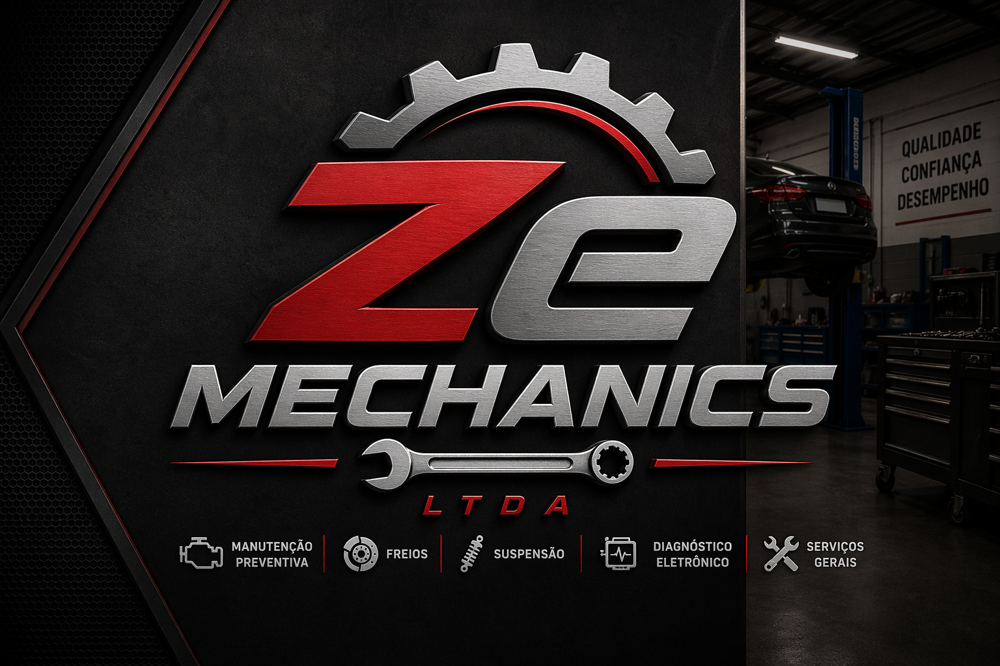
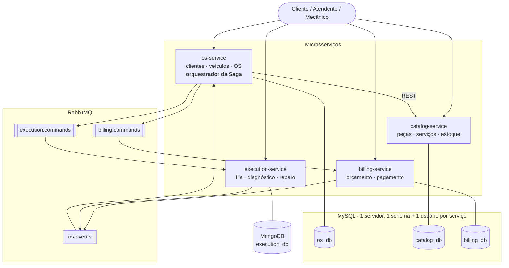
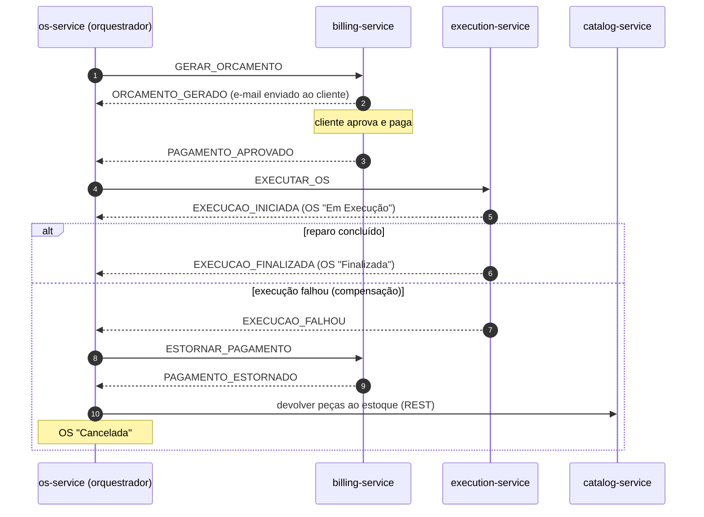

<div align="center">
    
</div>

<br>
<br>
<br>

# ZeMechanics

Seja muito bem-vindo à ZeMechanics!

A melhor mecânica da região de Osasco, a única com especialidade em desmanche de carro, seja blindado ou não!

>Também reparamos os carros feitos *só para rodar*!! 

## Resumo - Fase 4

A oficina cresceu e passou a operar com várias filiais. Para aguentar o volume e ser tolerante a falhas, o monólito da Fase 3 foi dividido em **4 microsserviços independentes**, cada um com o seu próprio banco, que conversam por **REST** (síncrono) e por **RabbitMQ** (assíncrono).

As transações que atravessam vários serviços (abrir a OS → orçamento → pagamento → execução) são coordenadas pelo **Saga Pattern orquestrado**, com **compensação** (rollback) quando qualquer etapa falha.

Todo o código continua em **Python + FastAPI**, seguindo a mesma estrutura de camadas do monólito (`api → services → repositories → domain`).

## Índice

* ➡️ [Arquitetura](#arquitetura)
* ➡️ [Microsserviços](#microsserviços)
* ➡️ [Saga Pattern](#saga-pattern)
* ➡️ [Como rodar](#como-rodar-docker-compose)
* ➡️ [Testes e cobertura](#testes-e-cobertura)
* ➡️ [Cenários de teste da Saga](docs/fase4/cenarios_saga.md)
* ➡️ [Fases anteriores](#fases-anteriores)

## Stack

<p align="center">
          
</p>

## Arquitetura



### Decisões

| Tema | Decisão | Por quê |
|---|---|---|
| Divisão | 4 serviços: OS, Catálogo, Billing e Execução | Cada um tem uma responsabilidade de negócio clara. O catálogo saiu do os-service para aplicar responsabilidade única: o os-service gerencia a OS, o catálogo gerencia peças e estoque. |
| Banco relacional | **1 servidor MySQL**, com **1 schema e 1 usuário por serviço** | O isolamento é garantido pelo próprio banco (`GRANT` só no próprio schema): o `os_user` não consegue ler o `catalog_db`. Mantém o custo de 1 instância no RDS. Contrapartida: se o MySQL cair, os 3 serviços SQL caem juntos. |
| Banco não relacional | **MongoDB** no execution-service | Uma execução é naturalmente um documento: OS, serviços e histórico juntos, sem JOIN. |
| Comunicação síncrona | **REST** do os-service para o catalog-service | O os-service precisa da resposta na hora (a peça existe? tem estoque?). |
| Comunicação assíncrona | **RabbitMQ** entre os-service, billing e execution | O fluxo da OS leva horas ou dias (o cliente aprovar, o mecânico consertar). Se um serviço cair, a mensagem espera na fila e não se perde. |
| Transação distribuída | **Saga orquestrada** pelo os-service | Ver [Saga Pattern](#saga-pattern). |
| Autenticação | Fica no **AWS API Gateway + Lambda** (Fase 3) | Os serviços não repetem a lógica de JWT. |

## Microsserviços

Cada pasta é um serviço independente (código, Dockerfile, testes e README próprios) e será publicada em um repositório próprio.

| Serviço | Porta (compose) | Banco | Documentação |
|---|---|---|---|
| **os-service** | 8000 | MySQL `os_db` | [os-service/README.md](os-service/README.md) |
| **catalog-service** | 8001 | MySQL `catalog_db` | [catalog-service/README.md](catalog-service/README.md) |
| **billing-service** | 8002 | MySQL `billing_db` | [billing-service/README.md](billing-service/README.md) |
| **execution-service** | 8003 | MongoDB `execution_db` | [execution-service/README.md](execution-service/README.md) |

Cada serviço expõe o **Swagger** em `http://localhost:<porta>/docs`.

## Saga Pattern

**Estratégia escolhida: orquestração**, com o orquestrador dentro do próprio **os-service** ([`saga_service.py`](os-service/app/services/saga_service.py)).



### Por que orquestração (e não coreografia)

* **O fluxo tem um dono claro: a OS.** Faz sentido um único serviço conhecer a sequência inteira e decidir o próximo passo.
* **Tudo em um lugar só.** As regras de avanço e de compensação ficam em um único arquivo, fácil de ler, testar (100% de cobertura) e demonstrar.
* **Rastreabilidade.** Cada passo da Saga é gravado no histórico da OS (`GET /ordem_servico/historico/{id}`), o que responde "onde a OS travou?" com uma chamada.
* **Participantes simples e desacoplados.** O billing e o execution não se conhecem: só recebem comandos e respondem com eventos.
* **Sem serviço extra.** O orquestrador mora no os-service, então não foi preciso criar um 5º serviço.

A contrapartida é que o os-service conhece o fluxo inteiro: uma mudança no processo passa por ele. Com 3 participantes, isso é aceitável e mais simples que espalhar o fluxo em eventos (coreografia).

### Compensações

| Falha | Compensação | Status final da OS |
|---|---|---|
| Cliente reprova o orçamento | Devolve as peças ao estoque | Reprovada |
| Pagamento recusado | Devolve as peças ao estoque | Cancelada |
| Execução falha | Estorna o pagamento → devolve as peças ao estoque | Cancelada |

### Garantias e limitações

* **Idempotência:** o RabbitMQ entrega cada mensagem *pelo menos uma vez*. Todo passo confere o estado atual antes de agir, então uma mensagem repetida não faz nada duas vezes (por exemplo, não devolve o estoque duas vezes).
* **Dead Letter Queue:** toda fila tem uma `<fila>.dlq`. Uma mensagem que falha no processamento vai para lá em vez de travar a fila ou se perder.
* **Publicar antes de gravar:** onde é possível, o serviço publica a mensagem antes de mudar o status. Se o RabbitMQ estiver fora, a API responde `503` e nada muda pela metade.
* **Limitação conhecida:** gravar no banco e publicar na fila não são uma operação atômica. A solução completa é o padrão *Transactional Outbox*, que não foi implementado para manter o código simples.

## Como rodar (docker compose)

```bash
docker compose up --build -d
docker compose ps
```

| O quê | URL |
|---|---|
| os-service | http://localhost:8000/docs |
| catalog-service | http://localhost:8001/docs |
| billing-service | http://localhost:8002/docs |
| execution-service | http://localhost:8003/docs |
| Painel do RabbitMQ | http://localhost:15672 (guest / guest) |
| Maildev (e-mails de aprovação) | http://localhost:1080 |

Para simular pagamento recusado:

```bash
MOCK_PAGAMENTO_STATUS=rejected docker compose up -d billing-service
```

## Testes e cobertura

| Serviço | Testes | Cobertura |
|---|---|---|
| os-service | 175 (inclui 4 cenários **BDD** da Saga) | 94% |
| catalog-service | 57 | 88% |
| billing-service | 42 | 96% |
| execution-service | 24 | 96% |

* **Unitários e integração:** dentro de cada serviço (ver o README de cada um).
* **BDD:** [os-service/tests/features/saga_ordem_servico.feature](os-service/tests/features/saga_ordem_servico.feature), em português, com `pytest-bdd`.
* **Ponta a ponta (com o compose no ar):** `bash scripts/testar-saga.sh todos`. Ver [cenários da Saga](docs/fase4/cenarios_saga.md).

## Fases anteriores

* ➡️ [Como implementar - Terceira etapa (Depreciado)](docs/como-implementar-terceira-etapa-projeto.md)
* ➡️ [Como implementar - Segunda etapa (Depreciado)](docs/como-implementar-segunda-etapa-projeto.md)

## 📫 Vamos nos conectar?

<p align="center">
  <a href="https://www.linkedin.com/in/jgsiqueiraa/">
    
  </a>
  <a href="https://github.com/cl0uD-C1SC0">
    
  </a>
</p>

<br><br>


<h4 align="center">
   © 2026 Ze Mechanics LTDA. O lugar perfeito para carro de leilão, feito apenas para rodar. 🚀
